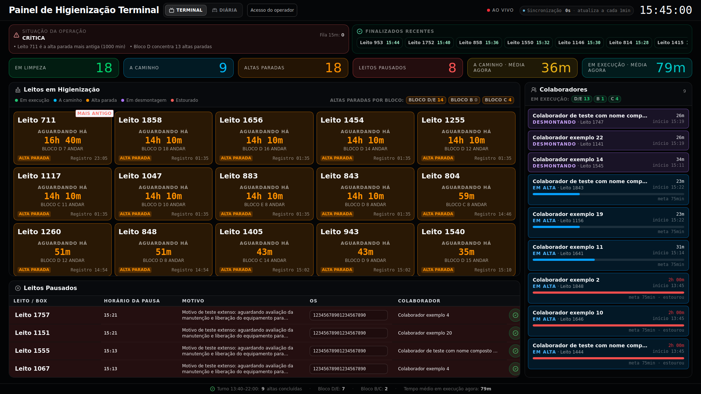
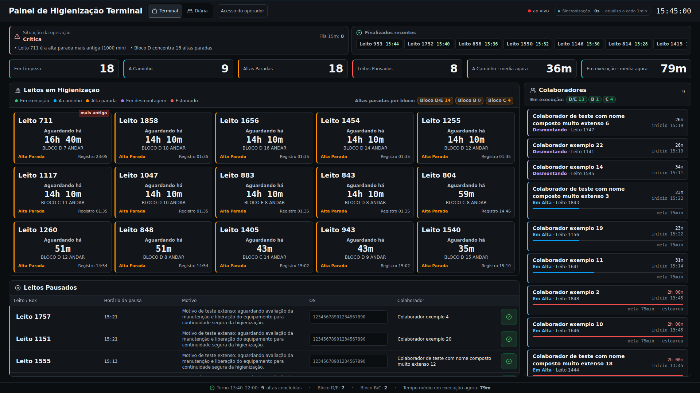
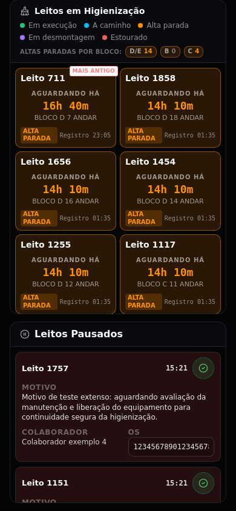
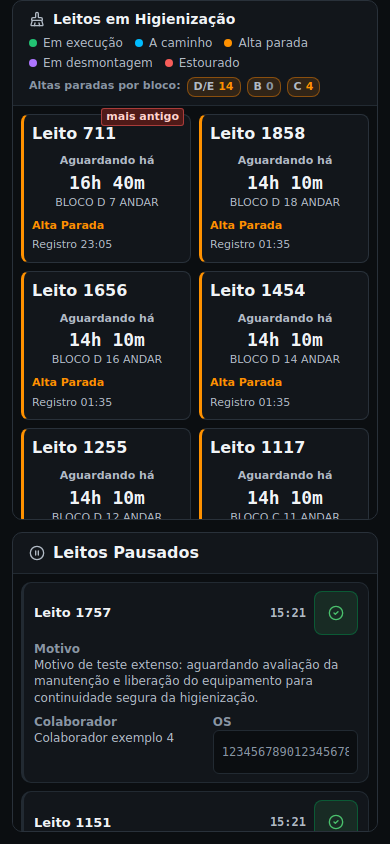
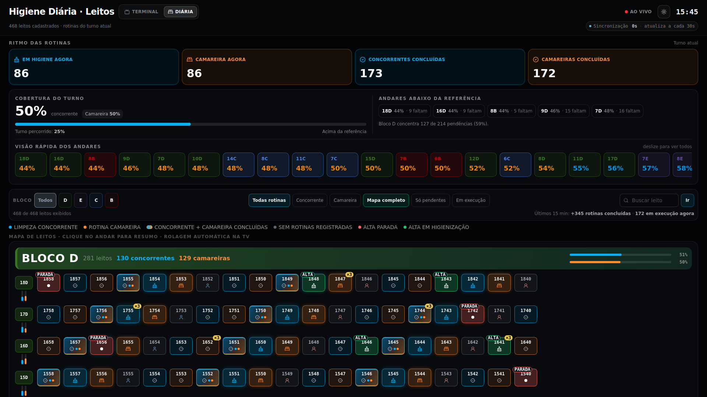
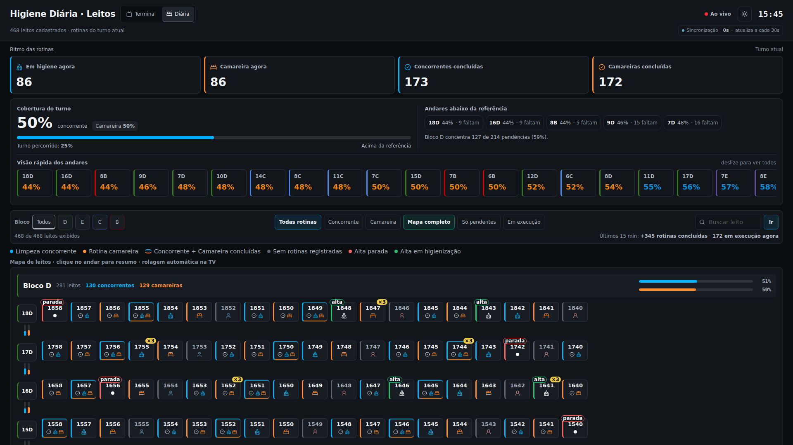
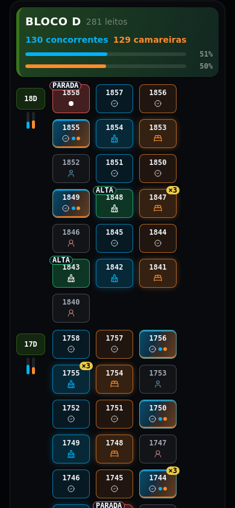
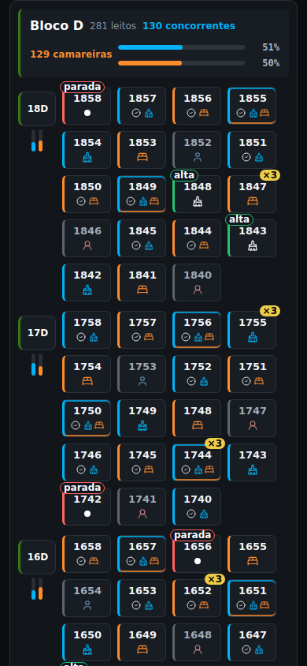

# Quiet Operations 1.0 — revisão visual

Redesign de apresentação do Terminal (`/tv`) e da Diária (`/diaria`), baseado na `main` **4f62aec**. Não há merge nem publicação nesta entrega.

## Diagnóstico confirmado no código e no navegador

- `tv.tsx`: superfícies, contornos, nomes, números e status acumulavam a mesma cor; KPIs usavam Bebas Neue; textos essenciais de 9–10px e maiúsculas competiam com os dados. A linha de status disputava espaço com o horário em cards estreitos.
- `diaria.tsx`: cabeçalhos de blocos com gradientes e títulos muito pesados; mini-cards com preenchimentos, brilho e gradiente duplo; KPIs e panorama com várias superfícies coloridas.
- `styles.css`: duas camadas tardias de superfícies escuras com `!important`, além de brilho no contador, entradas laterais e pulsação dos mini-cards.
- `DischargeTimelineModal.tsx`: arredondamentos de 22px, muitos contornos internos, pequenas legendas e botão de fechamento de 40px.
- O navegador também confirmou um aviso React preexistente na Diária: uso simultâneo de `background` e `backgroundImage`. A propriedade de cor agora é `backgroundColor`.

## O que mudou

| Componente | Refinamento |
| --- | --- |
| Tokens e superfícies | Referências fornecidas convertidas para OKLCH; escopo exclusivo `.tv-terminal-page` e `.dark.daily-panel-page`; bordas discretas e superfícies neutras. |
| Header / PanelNav | Navegação segmentada, relógio menor, hierarquia tipográfica consistente, indicador vermelho estático. CSS do menu limitado às duas telas; rotas preservadas. |
| SyncCounter | Classe visual escopada; legenda de frequência também visível no celular. Contador, intervalos e alertas intactos. |
| KpiCard / Kpi | Valor claro, superfície neutra e faixa de 3px; mesmos indicadores e tendências; duas colunas no celular. |
| TerminalBedsPanel | Todos os cards e suas chaves preservados. Faixa operacional, status e progresso mantêm as cores; nomes e tempos claros; status/horário podem quebrar linha sem disputar largura. Selo “mais antigo” legível. |
| Situação / finalizados | Superfícies neutras; situação crítica com faixa e texto explícito; carrossel original preservado. |
| StaffPanel | Linhas neutras, faixa da atividade, progresso fino; nomes longos podem quebrar linha. |
| BedsPanel / OS | Tabela neutra; motivo e colaborador podem ocupar múltiplas linhas. Cards mobile preservados; OS passa a uma coluna em telas estreitas; controles de toque com 44px. |
| Modal do Terminal | Grafite, raio de 12px, títulos e separadores mais simples, fechamento confortável; dados, histórico e gestão de foco preservados. |
| Blocos / andares da Diária | Cabeçalho neutro com faixa oficial do bloco, títulos menores e indicadores existentes alinhados. Cores oficiais mantidas literalmente. |
| BedTile | 62×48px; superfície neutra, duas faixas para dupla rotina, sem glow contínuo no escuro. Ícones de higiene/camareira também nas conclusões distinguem as rotinas por forma, além da cor; check de conclusão preservado. |
| Filtros / cobertura | Superfícies consistentes, texto legível e rolagem interna dos filtros. Mesmas opções e callbacks. |
| Animações | Entradas e mudanças curtas, sem escala repetitiva ou brilho de sincronização. Disparos existentes preservados; movimento reduzido respeitado. |

## Comparação no navegador

São **screenshots dos componentes reais do repositório**, renderizados com registros sintéticos e relógio de referência. Não são imagens geradas nem dados do hospital. A mesma fixture foi utilizada antes/depois. O popup de novidades foi fechado pela ação existente antes das capturas.

| Tela | Antes | Depois |
| --- | --- | --- |
| Terminal · 1920px |  |  |
| Terminal · cards mobile · 390px |  |  |
| Diária · 1920px |  |  |
| Diária · mapa mobile · 390px |  |  |

Outros estados: [Terminal em execução/estourados](after/tv-1920-active.png), [modal Terminal 320px](after/tv-320-modal.png), [modal Diária 320px](after/diaria-320-modal.png), [Diária clara](after/diaria-1920-light.png), [pausados em touch 320px](after/tv-320-paused-touch.png).

## Proteção operacional e PR #47

A PR [#47](https://github.com/oliveirampd/painelhigienehsl/pull/47) estava **aberta, em rascunho e não integrada** na inspeção. Este redesign parte da `main`; não inclui nem reverte suas correções. A simulação de merge de três vias de `tv.tsx` com o head `849adcc` terminou sem conflitos. A prioridade de colaborador/estágio continua sendo responsabilidade daquela PR e deve ser revalidada na integração final.

Inspeção do diff: nenhum arquivo de banco, integração, hook de dados, endpoint, sincronização, configuração Cloudflare/Supabase, dependências ou workflow foi alterado. Hooks, dependências, callbacks, chaves React, classificações, filtros, ordenação e cálculos foram preservados. As mudanças TSX se limitam a classes, estilos, um atributo visual de estado e aos ícones de rotina já disponíveis no Lucide.

`AutoScroll.tsx`, `useCarouselScroll.ts`, `ThemeToggle.tsx` e a implementação de `PanelNav.tsx` permanecem intactos. O Terminal mantém 60s e a Diária mantém 30s, conforme o código atual — este trabalho não uniformiza frequências.

## Como reproduzir

Validações do projeto, sem novas dependências:

```sh
node --test tests/*.test.mjs
npm run build
npx tsc --noEmit
```

Teste visual opcional (Playwright disponível em um ambiente de testes separado):

```sh
NODE_PATH=/caminho/test-tools/node_modules \
QH_CHROMIUM=/caminho/chromium \
node tests/visual/quiet-operations.cjs . /tmp/quiet-operations
```

O teste inicia o Vite e monta as opções de componente das rotas reais em um router de teste. Esse isolamento é necessário porque o SSR local da `main` importa `cloudflare:workers`, indisponível no Node. Nenhuma adaptação foi inserida na aplicação para acomodar o teste. Requisições de dados e WebSockets são interceptados; mutações não são encaminhadas. O teste não substitui homologação em Cloudflare nem valida a conectividade real com Listo/Supabase.

O script mede 320, 360, 390, 430, 768, 1024, 1365, 1920 e 3840px, testa foco e fechamento de modais, filtros combinados, pesquisa, feedback de conclusão, poucos/muitos leitos, toque e rolagem. O relatório JSON registra os resultados, inclusive limitações preexistentes.

## Resultados e limitações

- Build de produção e TypeScript: **passaram**. Permanecem os avisos de tooling/chunk grande já presentes; nenhuma dependência foi adicionada.
- Seis suítes existentes: **6/6 passaram** — Terminal motion, daily aggregation, Listo safety, paginação e parsers de previsões CSV/XLS.
- Chromium 134 / Playwright 1.62.1: **18 combinações tela/largura sem overflow horizontal**, incluindo 320 e 3840px; nenhum elemento escapando da página fora de containers de rolagem interna.
- Modais 320×640: largura contida, rolagem interna, foco dentro do diálogo após Tab e fechamento por Escape nas duas páginas.
- Tema claro: seletor e layout verificados em 320, 390, 768 e 1920px, sem overflow. [Comparação com o claro anterior](before/diaria-1920-light.png). O tema claro conserva suas cores e limitações de contraste preexistentes; não recebeu uma nova identidade.
- Fixture com 81 altas/desmontagens e snapshots recentes, 24 colaboradores sintéticos, motivos/nomes extensos e vários blocos/andares. Cenário reduzido com 3 cards também verificado.
- Filtros combinados bloco D + andar 7 + concorrente; pesquisa 1858 com destaque; conclusão recente disparada pela atualização da fixture: **verificados**.
- Controles touch em 320px: OS com 44px de altura; conclusão com 44×44px; sem overflow.
- Contraste de texto no escuro: **452 amostras no Terminal e 698 na Diária**, sem violações nos limites 4.5:1 / 3:1 conforme tamanho. O baseline tinha 49 e 33 violações, respectivamente. É uma medição automatizada de cor computada sobre superfícies, não certificação completa de acessibilidade nem teste em TV física.
- As cores oficiais de bloco não foram clareadas. Em particular, a faixa roxa oficial pode ficar abaixo de 3:1 contra a superfície: o bloco também é identificado por texto de alto contraste, sem depender exclusivamente da cor.
- Console: **nenhum erro registrado na versão final**. O aviso anterior `background/backgroundImage` foi eliminado.
- Rolagem Terminal: pausa manual mantida e retomada observada após 15s. Diária: pausa funciona, mas a retomada automática **não foi observada neste Chromium**, tanto no baseline quanto no redesign. Hook intacto; requer conferência no navegador da TV, em tarefa operacional separada.
- Não houve teste em Samsung TV física, Safari/iPhone ou no Worker de produção. Nenhuma escrita real em Listo/Supabase foi feita. O SSR Cloudflare não foi exercitado pelo teste de componentes.

Densidade: cards completamente contidos na área visível, mesma fixture e viewport, antes/depois:

| Viewport | Terminal antes → depois | Diária antes → depois |
| --- | ---: | ---: |
| 1024×900 | 4 → 4 | 0 → 0 (mapa abaixo da dobra) |
| 1365×900 | 5 → 10 | 19 → 19 |
| 1920×1080 | 10 → 15 | 76 → 76 |
| 3840×2160 | 40 → 40 | 334 → 309 (−7,5%) |

O mapa mantém cards de 62×48px. A redução em 4K fica dentro da tolerância solicitada de aproximadamente 10%. No mobile a ordem original das seções foi preservada; a leitura dos cards foi conferida após rolagem até o painel de leitos.

Evidências estruturadas: [baseline](before-report.json) e [resultado](after-report.json).

## Arquivos alterados

| Arquivo | Motivo |
| --- | --- |
| `src/styles.css` | Tokens escopados, superfícies, tipografia, responsividade e acabamento das animações; substituição das antigas sobreposições escuras. |
| `src/routes/tv.tsx` | Classes/estilos dos elementos existentes, quebra da linha de status, OS responsiva e tamanho do controle de conclusão. |
| `src/routes/diaria.tsx` | Classes/estilos com fallback claro; mini-cards e indicadores por ícone; correção de conflito de propriedades CSS. |
| `src/components/SyncCounter.tsx` | Uma classe para aplicação visual limitada às duas páginas. |
| `src/components/DischargeTimelineModal.tsx` | Raios, fontes e dimensões de fechamento. |
| `tests/visual/entry.tsx` | Montagem de componentes reais exclusiva do teste, fora das rotas da aplicação. |
| `tests/visual/quiet-operations.cjs` | Fixtures, interceptação de rede, capturas e verificações de viewport/foco/estados. |
| `docs/quiet-operations/` | Diagnóstico, limitações, relatórios e comparações antes/depois. |
